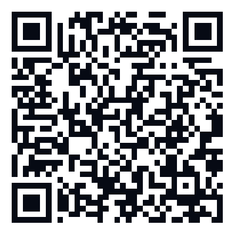

# 💧 TankiAlert

A macOS menu bar app (macOS 13+, SwiftUI) that plays your "pani ki tanki bhar gayi" clip and posts a
notification when the Mac is on AC power and the battery reaches your threshold. It fires once per charge cycle.

## Build

```bash
./build.sh          # -> build/TankiAlert.app and build/TankiAlert.zip
```

- With full Xcode installed, `build.sh` runs `xcodegen generate` and then
  `xcodebuild -scheme TankiAlert -configuration Release -derivedDataPath build build`.
- With only the Command Line Tools installed, it compiles `Sources/*.swift` with `swiftc` for arm64 and x86_64,
  assembles the `.app` bundle from `Support/Info.plist`, and ad-hoc signs it.
- If `~/tanki.mp3` (or `.m4a` / `.wav`) exists, it is copied into `Sources/Resources/` and bundled.

### App icon

`Sources/Resources/AppIcon.icns` is generated from `Support/icon/logo-source.png`. To swap the logo, replace that
PNG and run `Support/icon/make-icns.sh`. The script removes the black background so the corners are transparent,
fits the artwork onto the standard macOS icon grid (an 824 px rounded square, which macOS 26 shows without a grey frame), and builds every icon size. Then run `./build.sh`.

## Install & run

```bash
rm -rf ~/Applications/TankiAlert.app && cp -R build/TankiAlert.app ~/Applications/
open ~/Applications/TankiAlert.app
```

The app has no Dock icon. Click the battery icon in the menu bar. The icon shows a bolt while you're on AC.

## How it works

- `IOPSNotificationCreateRunLoopSource` delivers instant power-source updates, and a 30 s timer polls as a fallback.
- The alert fires when on AC, enabled, the battery is at or above the threshold, and it hasn't already fired this cycle.
- It re-arms when you unplug, when the battery drops 3 or more points below the threshold, or when you set a new
  threshold above the current %.
- The sound is your chosen file, else the bundled `tanki.*`, else the system Glass sound. It plays 1–5 times.
- Settings (enabled, threshold, repeats, sound) are stored in `UserDefaults` (`com.chetan.tankialert`).

## Testing

```bash
APP=~/Applications/TankiAlert.app/Contents/MacOS/TankiAlert
$APP --print-battery           # compare with: pmset -g batt
```

Quick end-to-end test while plugged in: drag the slider down to the current battery %. The alert fires straight away.
From the terminal, the same check with logs looks like this:

```bash
open -n ~/Applications/TankiAlert.app --stderr /tmp/tanki.log --args --debug --set-threshold 80
cat /tmp/tanki.log   # look for "FIRED at …"
```

`--set-threshold` saves the threshold just like the slider does, so set it back afterwards.

## Notes

- If you use macOS "Optimized Battery Charging" or an 80% charge limit, the battery may never reach 100%.
  Set the threshold to 80 in that case.
- Allow notifications under System Settings → Notifications → TankiAlert.
- Launch at login uses `SMAppService.mainApp`. It works best from `~/Applications` or `/Applications`.

## Website

The marketing site lives in [`../web`](../web/README.md) (Next.js static export, deployed on Vercel). Its Download
button points at `https://github.com/chetanpujari5105/Pani-ki-Tanki/releases/latest/download/TankiAlert.zip`, so
attach `build/TankiAlert.zip` (named exactly `TankiAlert.zip`) to each GitHub Release.

## Support

TankiAlert is free and open source. If it saved your battery (or made you laugh), you can help fill the tanki 💧.
Donations are optional and go into updates.

- **In India (UPI):** scan this with GPay, PhonePe, Paytm or any UPI app.

  

- **Outside India:** [Support on Ko-fi](https://ko-fi.com/chetan46146) (card or PayPal).

The QR is generated from `web/lib/donate.ts` by `npm run qr` (inside `web/`).
